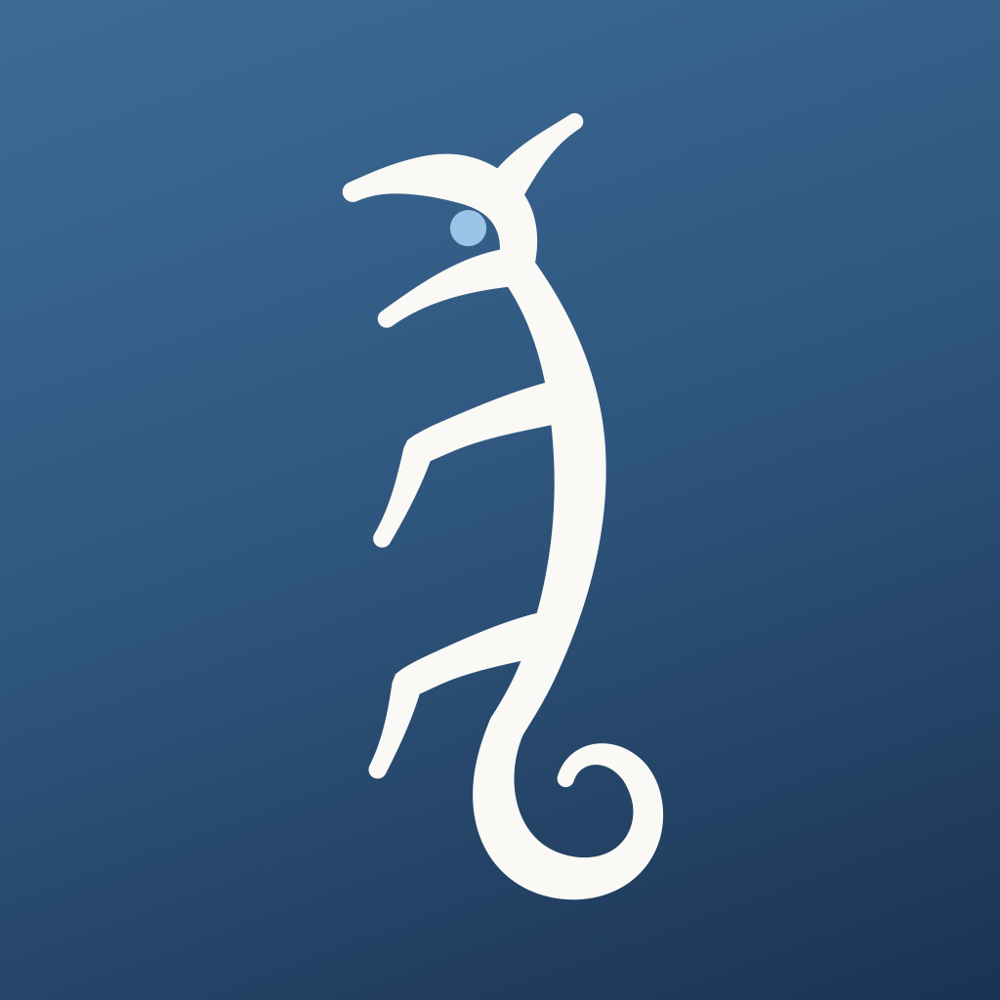

<div align="center">
  <picture>
    <source media="(prefers-color-scheme: dark)" srcset="Memos/Resources/Assets.xcassets/AppIcon.appiconset/AppIcon-Dark.png">
    
  </picture>

  <h1>Memos for iOS</h1>

  <p>
    A native iOS &amp; iPadOS client for self-hosted <a href="https://github.com/usememos/memos">Memos</a>.<br>
    <em>Paper for what you wrote, Liquid Glass for what you do.</em>
  </p>

  <p>
    
    
    
    <a href="https://github.com/usememos/memos"></a>
    
  </p>

  <p>
    <a href="#features">Features</a> ·
    <a href="#server-compatibility">Server Compatibility</a> ·
    <a href="#getting-started">Getting Started</a> ·
    <a href="#testing">Testing</a> ·
    <a href="#project-layout">Project Layout</a> ·
    <a href="#url-schemes--deep-links">Deep Links</a>
  </p>
</div>

---

## Features

- **Offline-first sync & standalone on-device mode** — Full local archive with an outbox queue, chunked attachment uploads, and content-based conflict detection. Also works completely without a server via an independent on-device library.
- **Native authoring & rendering**
  - Markdown with syntax-highlighted code blocks and native CoreText LaTeX math (`$…$` and `$$…$$` via [SwiftMath](https://github.com/mgriebling/SwiftMath)).
  - Memo-to-memo references and natural-language date suggestions (e.g. `"tomorrow 8pm"`).
  - Clipboard image pasting, camera capture, document scanning, and location tagging.
  - Voice memos with live waveform recording and on-device transcription.
- **Powerful search & on-device photo search** — Local CEL-backed memo filtering, saved views, attachment and tag filters, Spotlight indexing, and optional on-device semantic photo search powered by Apple's Core ML **MobileCLIP** (`S0` / `S2`, downloaded on demand with SHA-256 verification).
- **Spaces, Library & Privacy** — Full support for Spaces, Inbox, comments, reactions, and a Library hub (activity heatmap, attachments browser, places map, tags, and archive). Tag blur rules keep sensitive memos redacted across the timeline, widgets, Spotlight, and Shortcuts.
- **Deep Apple platform integration** — Adaptive iPad split view, Home & Lock Screen widgets (**Quick Capture**, **Pinned**, **Memory**, **On This Day**, **Activity**), Control Center controls (**New Memo**, **Voice Memo**), Share Extension, App Intents / Shortcuts, Home Screen quick actions, and URL schemes.
- **Flexible sign-in & localization** — Password, SSO (`memos://auth/callback`), and Personal Access Token authentication backed by Keychain. Localized in **English** and **Simplified Chinese (`简体中文`)**.

---

## Server Compatibility

| Memos Server | Status | Transport & Notes |
| --- | --- | --- |
| **26.11+** (and `main`, vendored at [`b40d8a7`](proto/UPSTREAM_COMMIT)) | Supported & tested | `memos.api` over binary protobuf via Connect-Swift |
| **0.31.x** | Supported & tested | `memos.api.v1` over Connect JSON with automatic field/method translation in [`ServerDialect.swift`](MemosKit/Sources/MemosAPI/ServerDialect.swift) |
| **0.30 and earlier** | Not supported | Rejected at sign-in (missing Spaces, saved views, and chunked uploads) |

### Protocol & Sync Notes

- **Automatic dialect detection & upgrades:** At sign-in, the app probes which API package the server speaks and saves it with the session. If a `0.31` server is later upgraded to `26.x`, subsequent syncs automatically detect the new API and switch over.
- **Authentication:** Supports password login (with `memos_refresh` cookie rotation stored in Keychain), SSO (configure your identity provider to allow the `memos://auth/callback` redirect URI), and Personal Access Tokens (for instances without password/SSO login; PAT sessions sign out when expired or revoked).
- **Sync & conflict handling:** Text, attachment, and location edits update `update_time`. Pinning, archiving, or visibility changes made elsewhere on the web do not advance `update_time` on the server, so they arrive on the next full reconciliation (pull-to-refresh or daily on Wi-Fi). Conflicts compare server content against the base revision rather than relying on `update_time` alone.

---

## On-Device Mode (Without a Server)

Choose **Use Without a Server** on the sign-in screen to use Memos as a standalone local notebook.

- Memos and attachments stay strictly inside `<app group>/OnDevice/` and never upload.
- Local capabilities—search, tags, saved views, Library, widgets, Share Extension, Spotlight, and Shortcuts—work identically; server-only features (comments, reactions, Spaces, Inbox, share links, and visibility) are hidden.
- A server account and the on-device library are stored independently and can be switched in **Settings** without signing out. Signing out clears only the server account's local copy; erasing the on-device library leaves your server account untouched.

---

## Getting Started

### Prerequisites

- **Xcode 26** or later (targeting iOS / iPadOS 26.0, Swift 6.2)
- **[XcodeGen](https://github.com/yonaskolb/XcodeGen)** to generate `Memos.xcodeproj` from [`project.yml`](project.yml)
- **[buf](https://buf.build)** *(optional — only needed to regenerate the Swift API client from upstream protos)*

### Build & Run

```sh
git clone https://github.com/jcdiv47/memos-ios.git
cd memos-ios

xcodegen generate    # generates Memos.xcodeproj from project.yml
open Memos.xcodeproj
```

### Signing for a Physical Device

Set `DEVELOPMENT_TEAM` and `MEMOS_BUNDLE_PREFIX` in [`project.yml`](project.yml), then re-run `xcodegen generate`.

- The shared App Group (`group.<prefix>`) and Keychain Group (`<prefix>.shared`) derive automatically from `MEMOS_BUNDLE_PREFIX`, allowing the app, widgets, and share extension to share local storage and credentials.
- `MOBILECLIP_APP_GROUP` defines a separate App Group for the on-demand Core ML photo search model so multiple apps can share a single downloaded copy.

### Running Against a Local Memos Server

```sh
# In your usememos/memos checkout
go build -o /tmp/memos ./cmd/memos
/tmp/memos --port 5230 --data /tmp/memos-data --rate-limit=false

# Back in memos-ios: seed sample users (you / memos-dev, mira / memos-dev) and three Spaces
scripts/seed_dev_server.py
```

To test against Memos `0.31.0`, build the `v0.31.0` tag on another port (e.g. `5231`) and run `scripts/seed_dev_server.py http://localhost:5231`.

In the simulator, sign in at `http://localhost:5230` via password or Personal Access Token. Debug builds also support launch environment variables for automated testing and screenshots:

| Variable | Purpose |
| --- | --- |
| `MEMOS_DEV_SERVER` | Auto-sign-in server URL (pair with `MEMOS_DEV_USER` + `MEMOS_DEV_PASSWORD`, or `MEMOS_DEV_TOKEN`) |
| `MEMOS_DEV_ON_DEVICE=1` | Launch directly into the on-device library |
| `MEMOS_DEV_RESET=1` | Start signed out and erase local data (including the on-device library) |
| `MEMOS_DEV_OPEN` | Space-separated `memos://` links to open immediately on launch |
| `MEMOS_DEV_CREATE` | Create a private memo with this text on launch |

### Regenerating the API Client

To track a newer upstream Memos server commit:

```sh
scripts/generate-api.sh /path/to/memos
```

This copies `proto/api/*.proto`, `buf.yaml`, and `buf.lock`, records the commit hash in [`proto/UPSTREAM_COMMIT`](proto/UPSTREAM_COMMIT), and regenerates `MemosKit/Sources/MemosAPI/Generated` via `buf generate`.

---

## Testing

### Unit & Sync Integration Tests (`MemosKit`)

`MemosKit` is a standalone Swift package testable directly on macOS:

```sh
cd MemosKit

# Offline suite: CEL filters, Markdown, visibility/blur rules, outbox, PhotoSearch
swift test

# Full suite including live sync against a local Memos 26.11+ server
MEMOS_TEST_SERVER=http://localhost:5230 swift test

# Same sync suite verified against Memos 0.31
MEMOS_TEST_SERVER=http://localhost:5231 swift test
```

The server integration suite exercises offline creation, pin/archive before upload, incremental sync, text conflict resolution, deletion reconciliation, chunked attachment uploads, lost-response retries, share-extension handoffs, and token refresh.

### UI Tests

Requires a seeded local Memos server:

```sh
TEST_RUNNER_MEMOS_TEST_SERVER=http://localhost:5230 xcodebuild test \
  -scheme Memos \
  -destination 'platform=iOS Simulator,name=iPhone 17 Pro'
```

---

## Project Layout

| Path | Description |
| --- | --- |
| [`Memos/`](Memos/) | SwiftUI app: timeline, composer, memo detail, search, Library, Inbox, Settings, App Intents, Spotlight indexing, and iPad split view |
| [`Memos/Design/`](Memos/Design/) | Design system tokens (spacing, radius, typography, color palettes, surfaces, motion springs, and shared components) documented in [`design/DESIGN_SYSTEM.md`](design/DESIGN_SYSTEM.md) |
| [`MemosKit/Sources/MemosAPI/`](MemosKit/Sources/MemosAPI/) | Generated Connect-Swift client, `MemosClient`, Keychain token/cookie session handling, and `ServerDialect.swift` for 0.31 compatibility |
| [`MemosKit/Sources/MemosCore/`](MemosKit/Sources/MemosCore/) | Offline store, outbox, sync engine, conflict resolution, CEL filter evaluator, search mapping, Markdown parser, visibility and tag blur rules |
| [`MemosKit/Sources/PhotoSearch/`](MemosKit/Sources/PhotoSearch/) | On-device semantic photo search using Core ML MobileCLIP encoders, tokenizer, and local vector index (linked only by the main app) |
| [`MemosWidgets/`](MemosWidgets/) | Home & Lock Screen widgets (Quick Capture, Pinned, Memory, On This Day, Activity) and Control Center controls |
| [`MemosShare/`](MemosShare/) | iOS Share Extension for saving text, links, and up to 10 images from other apps |
| [`MemosUITests/`](MemosUITests/) | End-to-end XCUITest suite running against a local Memos instance |
| [`proto/`](proto/) | Vendored upstream `proto/api/*.proto`, [`UPSTREAM_COMMIT`](proto/UPSTREAM_COMMIT), and [`buf.gen.yaml`](proto/buf.gen.yaml) |
| [`design/`](design/) | Original interactive design proposal ([`memos-ios-design.html`](design/memos-ios-design.html)) and design system specification ([`DESIGN_SYSTEM.md`](design/DESIGN_SYSTEM.md)) |
| [`scripts/`](scripts/) | API codegen ([`generate-api.sh`](scripts/generate-api.sh)), dev-server seeder ([`seed_dev_server.py`](scripts/seed_dev_server.py)), and app icon renderer ([`render-app-icon.swift`](scripts/render-app-icon.swift)) |

---

## URL Schemes & Deep Links

| Link | Action |
| --- | --- |
| `memos://new` (`?text=…`) | Open composer with share-sheet defaults (default visibility, no Space) |
| `memos://capture` | Open composer with the capture field's rules (current Space) |
| `memos://voice` | Start a new voice memo recording |
| `memos://memo/{uid}` | Open a specific memo |
| `memos://search?q=…` | Open search prefilled with a query |
| `memos://inbox` | Open Inbox |
| `memos://settings` | Open Settings |
| `memos://library/{activity\|attachments\|map\|tags\|archived}` | Open Library or a specific Library page |
| `memos://space/{id}` | Switch to a Space |
| `memos://scope/{mine\|everyone}` | Switch timeline scope |
| `https://<instance>/memos/{uid}` | Open a memo from your instance |
| `https://<instance>/memos/shares/{token}` | Open a shared memo link |

---

## Design & Contributing

UI work follows the visual and interaction system in [`design/DESIGN_SYSTEM.md`](design/DESIGN_SYSTEM.md) and [`design/memos-ios-design.html`](design/memos-ios-design.html): use semantic tokens for spacing, typography, motion, and warm-paper colors rather than hardcoded values or cool system grays.

Contributions, bug reports, and pull requests are welcome:

1. Run `xcodegen generate` after adding, removing, or moving files or build settings in `project.yml`.
2. Run `cd MemosKit && swift test` (and the server integration suite when touching sync or API code) before opening a PR.
3. Keep user-facing strings localized via Xcode String Catalogs (`.xcstrings`).
